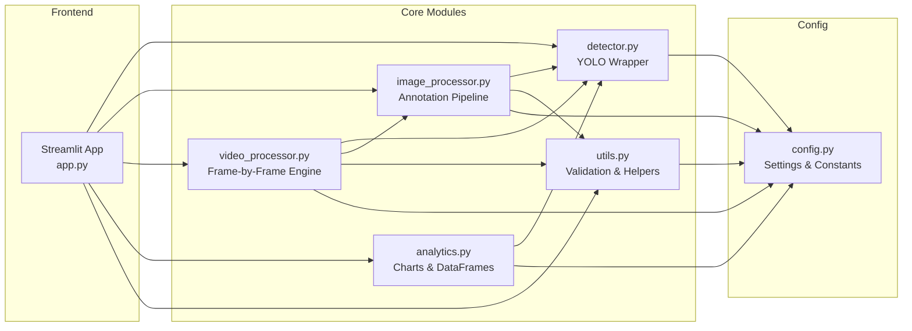
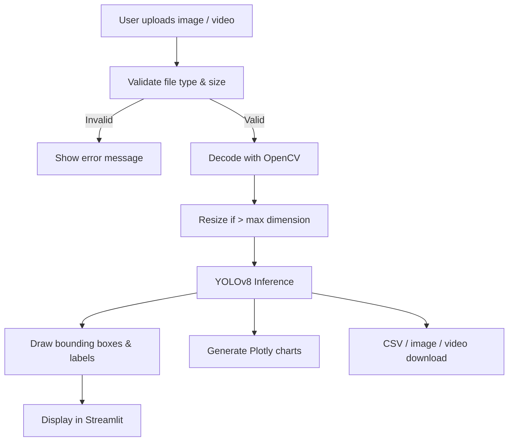

<div align="center">

# 🛩️ AeroVision

### AI-Powered Aerial Image & Video Analytics

[](https://python.org)
[](https://streamlit.io)
[](https://github.com/ultralytics/ultralytics)
[](https://opencv.org)
[](LICENSE)

A computer vision application that analyses aerial images and videos, detects objects using a pretrained YOLOv8 model, draws bounding boxes with confidence scores, and presents real-time analytics in a modern dark-themed dashboard.

**Educational research prototype** — no classified data, military hardware, or live surveillance equipment required.

</div>

---

## 📋 Table of Contents

- [Problem Statement](#-problem-statement)
- [Objectives](#-objectives)
- [Features](#-features)
- [Architecture](#-architecture)
- [Technology Stack](#-technology-stack)
- [Project Structure](#-project-structure)
- [Installation](#-installation)
- [Running the Application](#-running-the-application)
- [Model Setup & Troubleshooting](#-model-setup--troubleshooting)
- [Usage Guide](#-usage-guide)
- [Testing](#-testing)
- [Core Concepts](#-core-concepts)
- [Limitations](#-limitations)
- [Future Improvements](#-future-improvements)
- [Screenshots](#-screenshots)
- [License](#-license)

---

## 🎯 Problem Statement

Aerial surveillance generates vast volumes of imagery that are impractical to review manually. Automated object detection can assist analysts by highlighting regions of interest, classifying objects, and summarising findings — but building such a system requires integrating computer vision models, image/video processing pipelines, and an intuitive analytics interface.

**AeroVision** demonstrates how these components fit together in a clean, beginner-friendly codebase suitable for a Computer Science / Data Science portfolio.

---

## 🏁 Objectives

1. Apply a pretrained object detection model (YOLOv8) to aerial images and videos.
2. Provide an interactive dashboard for uploading media, viewing annotated results, and exploring detection analytics.
3. Keep the code modular, well-documented, and testable.
4. Clearly separate UI, detection logic, analytics, and utilities.
5. Export results (annotated images, processed videos, CSV reports).

---

## ✨ Features

| Feature | Description |
|---------|-------------|
| **Image Detection** | Upload JPG/PNG/WEBP images → view original & annotated side-by-side, detection table, download annotated image & CSV |
| **Video Detection** | Upload MP4/AVI/MOV → frame-by-frame preview *or* full export with progress bar, elapsed time, downloadable video |
| **Analytics Dashboard** | Class distribution bar chart, confidence histogram, detections-per-frame line chart, processing-time chart |
| **Model Settings** | Switch between YOLOv8n / s / m, configurable confidence threshold & max resolution |
| **Export & Reporting** | Download annotated images (PNG), processed videos (MP4), and CSV reports with class, confidence, bbox, timestamp |
| **Demo Mode** | Optional sample image — place `sample_aerial.jpg` in `assets/` to enable one-click demo |
| **Dark Theme UI** | Professional navy/charcoal/cyan design with metric cards, Plotly charts, responsive layout |

---

## 🏗 Architecture



**Data Flow**



---

## 🛠 Technology Stack

| Layer | Technology | Purpose |
|-------|-----------|---------|
| Web UI | **Streamlit** ≥ 1.30 | Interactive dashboard |
| Object Detection | **Ultralytics YOLOv8** | Pretrained COCO model (80 classes) |
| Image Processing | **OpenCV** (headless) | Decode, resize, annotate images |
| Image I/O | **Pillow** | PNG export |
| Data Handling | **Pandas**, **NumPy** | DataFrames, array operations |
| Visualization | **Plotly** | Interactive charts |
| Testing | **Pytest** | Automated unit tests |
| Language | **Python 3.11+** | |

---

## 📁 Project Structure

```
AeroVision/
├── app.py                  # Streamlit main entry point
├── config.py               # All tuneable settings & constants
├── requirements.txt        # Python dependencies
├── README.md               # This file
├── .gitignore              # Git ignore rules
├── src/
│   ├── __init__.py
│   ├── detector.py         # YOLO model loading & inference
│   ├── image_processor.py  # Image pipeline & annotation drawing
│   ├── video_processor.py  # Video frame processing & export
│   ├── analytics.py        # Plotly charts & DataFrame builders
│   └── utils.py            # Validation, formatting, helpers
├── tests/
│   ├── test_utils.py       # Tests for utility functions
│   └── test_analytics.py   # Tests for analytics & DataFrames
├── assets/
│   └── README.md           # Instructions for sample data
└── outputs/
    └── .gitkeep            # Generated files go here
```

---

## 💻 Installation

### Prerequisites

- **Python 3.11 or later** (tested with 3.11, 3.12, 3.13)
- **pip** package manager
- Internet connection (first run downloads ~6 MB model weights)

### Windows

```powershell
# 1. Clone the repository
git clone https://github.com/<your-username>/AeroVision.git
cd AeroVision

# 2. Create a virtual environment
python -m venv venv
venv\Scripts\activate

# 3. Install dependencies
pip install -r requirements.txt
```

### Ubuntu / macOS

```bash
# 1. Clone the repository
git clone https://github.com/<your-username>/AeroVision.git
cd AeroVision

# 2. Create a virtual environment
python3 -m venv venv
source venv/bin/activate

# 3. Install dependencies
pip install -r requirements.txt
```

---

## 🚀 Running the Application

```bash
# Activate your virtual environment first, then:
streamlit run app.py
```

The app opens in your browser at **http://localhost:8501**.

---

## 🤖 Model Setup & Troubleshooting

### How weights are downloaded

AeroVision uses `ultralytics.YOLO("yolov8n.pt")`. On the **first run** Ultralytics automatically downloads the weight file (~6 MB for Nano) from GitHub releases and caches it locally.

### Available models

| Model | Weight File | Size | Speed | Accuracy |
|-------|-------------|------|-------|----------|
| YOLOv8 Nano | `yolov8n.pt` | ~6 MB | ⚡ Fastest | Good |
| YOLOv8 Small | `yolov8s.pt` | ~22 MB | Fast | Better |
| YOLOv8 Medium | `yolov8m.pt` | ~50 MB | Moderate | Best |

All models detect the **80 COCO classes** (person, car, truck, bicycle, airplane, boat, bird, dog, …).

### No internet / download failed?

1. Manually download the `.pt` file from [Ultralytics releases](https://github.com/ultralytics/assets/releases).
2. Place it in the project root directory (same folder as `app.py`).
3. Restart the Streamlit app.

### Common errors

| Error | Solution |
|-------|----------|
| `ModuleNotFoundError: ultralytics` | Run `pip install ultralytics` |
| `RuntimeError: Failed to load model` | Check internet connection; manually download weights |
| `cv2.error: ... codec not found` | Install system codecs or use frame-preview mode |

---

## 📖 Usage Guide

1. **Dashboard** — View aggregate session statistics and charts.
2. **Image Detection** — Upload a JPG/PNG image → view side-by-side original & annotated → download.
3. **Video Detection** — Upload an MP4/AVI → choose Frame Preview or Full Export → view results.
4. **Analytics** — Explore class distribution, confidence histogram, per-frame counts, and processing times.
5. **Settings** — View current config, verify model status, clear session data.
6. **About** — Read project purpose, key concepts, and disclaimers.

### Demo Mode

Place a sample aerial image at `assets/sample_aerial.jpg` to enable the "Run Demo" button on the Image Detection page. Suggested public datasets:

- [VisDrone](https://github.com/VisDrone/VisDrone-Dataset)
- [DOTA](https://captain-whu.github.io/DOTA/)
- [Stanford Drone Dataset](https://cvgl.stanford.edu/projects/uav_data/)

---

## 🧪 Testing

```bash
# Run all tests
pytest tests/ -v

# Run a specific test file
pytest tests/test_utils.py -v
pytest tests/test_analytics.py -v
```

Tests cover:
- File validation (image & video)
- Image resizing and decoding
- Colour mapping
- Duration formatting & truncation
- DataFrame construction
- Chart generation (empty & non-empty data)
- Summary statistics

> Tests use synthetic data and do **not** require a GPU or model weights.

---

## 🧠 Core Concepts

### Object Detection
Finding *what* objects are in an image and *where* they are. The model outputs a list of bounding boxes, each with a class label and confidence score.

### YOLO (You Only Look Once)
A family of neural network architectures that process the entire image in a single forward pass, making them fast enough for real-time use. AeroVision uses **YOLOv8** by Ultralytics.

### Confidence Score
A value between 0 and 1 representing the model's certainty. Higher = more confident. The configurable threshold filters out low-confidence predictions.

### Bounding Box
A rectangle defined by its top-left `(x1, y1)` and bottom-right `(x2, y2)` corners, marking the spatial location of a detected object.

### Pretrained Model
A model already trained on a large labelled dataset (COCO — 80 everyday classes). It can be used out-of-the-box but is **not** optimized for specialised aerial imagery.

> **Important:** Pretrained-model performance depends on the dataset, camera angle, image quality, object size, and lighting conditions. For production aerial detection, fine-tuning on a domain-specific dataset is necessary.

---

## ⚠️ Limitations

1. **COCO classes only** — The pretrained model recognises 80 everyday object classes, not specialised aerial targets (e.g., military vehicles, runways). Fine-tuning is needed for domain-specific detection.
2. **Video codec support** — Full video export depends on system-level codec availability. If H.264 is unavailable, use frame-preview mode.
3. **No GPU required but recommended** — Inference runs on CPU if no CUDA GPU is present; processing will be slower.
4. **Large videos** — Processing is capped at a configurable frame limit to prevent memory issues.
5. **No real-time streaming** — Streamlit does not support native live video streaming; this is a batch-processing tool.
6. **Single-session state** — Analytics are per browser session and reset on page refresh.

---

## 🔮 Future Improvements

- [ ] Fine-tune YOLOv8 on an aerial/drone-specific dataset (e.g., VisDrone)
- [ ] Add object tracking (DeepSORT / ByteTrack) for video sequences
- [ ] Implement heatmap overlays for dense detection areas
- [ ] Multi-image batch processing
- [ ] Geospatial overlay on map tiles for geo-tagged imagery
- [ ] Docker containerisation for one-command deployment
- [ ] GPU-accelerated inference with TensorRT / ONNX Runtime
- [ ] User authentication and persistent session history

---

## 📸 Screenshots

> **Tip:** After running the app, take screenshots and place them in an `assets/screenshots/` folder, then update the paths below.

| Dashboard | Image Detection | Video Analytics |
|-----------|----------------|-----------------|
| *Screenshot here* | *Screenshot here* | *Screenshot here* |

---

## 📄 License

This project is released for educational purposes. Feel free to use, modify, and share it in your portfolio.

---

<div align="center">
<br>
Built with ❤️ as an educational AI/CV research prototype.<br>
<b>Not affiliated with any government or military organization.</b>
</div>
